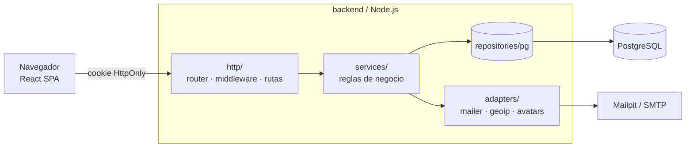

# Arquitectura

## Capas (backend)
| Capa | Carpeta | Responsabilidad | No debe |
|---|---|---|---|
| HTTP | `src/http` | Rutas, cookies, validación de origen, límite de intentos, formato de errores | contener reglas de negocio |
| Servicios | `src/services` | Reglas de las historias (login, roles, bloqueo…) | tocar SQL o `req/res` |
| Repositorios | `src/repositories/pg` | SQL | decidir reglas |
| Adaptadores | `src/adapters` | Correo, geolocalización, archivos | — |
| Dominio | `src/domain` | Módulos/permisos, roles base, serializadores | — |

`createApp({ config, repos, mailer, geoip, avatars })` recibe todo lo externo por parámetro. Por eso las pruebas ejecutan la API HTTP real sobre repositorios en memoria, y el CI repite los flujos clave contra PostgreSQL.

## Sesión y autorización
1. Login correcto → token aleatorio de 256 bits en cookie `ca_session` (`HttpOnly`, `SameSite=Lax`, `Secure` en producción). En la BD solo está su SHA-256.
2. Cada request: se busca la sesión → usuario → rol → permisos **en la BD**. No hay permisos incrustados en el token, así que un cambio de permisos, un bloqueo o una desactivación de rol rigen de inmediato.
3. `requirePermission(modulo, accion)` protege cada endpoint. El rol `super_admin` tiene todo.

## Medidas de seguridad incluidas
- Contraseñas con scrypt y sal única; verificación en tiempo constante; hash «señuelo» cuando el correo no existe.
- Mensajes de login y recuperación idénticos exista o no la cuenta.
- Límite de intentos por IP en login, registro y recuperación (memoria; válido para una instancia).
- CSRF: `SameSite=Lax` + el servidor exige `application/json` + rechaza `Origin` no permitido en métodos que escriben.
- Cabeceras `nosniff`, `X-Frame-Options: DENY`, CSP básica.
- Fotos: validación por contenido (magic bytes), tope de 2 MB, nombre generado por el servidor.
- Anti-escalada: solo un Super Administrador gestiona Super Administradores; nadie cambia su propio rol ni los permisos de su propio rol.

## Fuera de alcance de esta entrega (anotado para el futuro)
Verificación de correo al registrarse, doble factor, bloqueo automático por intentos fallidos, limitador de intentos compartido entre instancias (Redis), almacenamiento de fotos en S3/MinIO, exportación CSV de la auditoría, retención/purga de `access_logs`.
