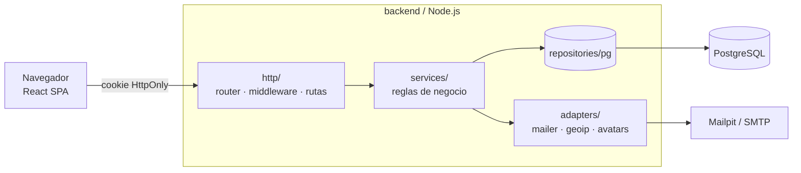
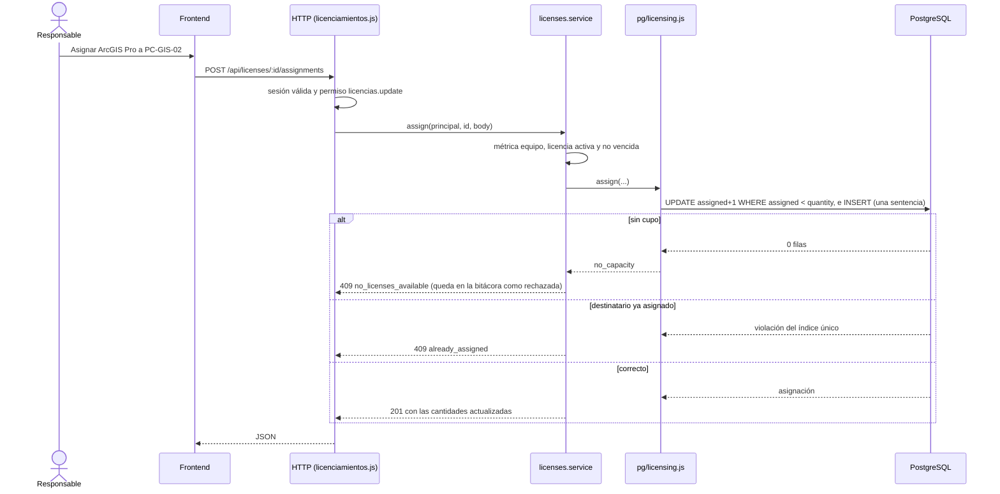

# Arquitectura

## Capas (backend)
| Capa | Carpeta | Responsabilidad | No debe |
|---|---|---|---|
| HTTP | `src/http` | Rutas, cookies, validación de origen, límite de intentos, formato de errores | contener reglas de negocio |
| Servicios | `src/services` | Reglas de las historias (login, roles, bloqueo…) | tocar SQL o `req/res` |
| Repositorios | `src/repositories/pg` | SQL | decidir reglas |
| Adaptadores | `src/adapters` | Correo, geolocalización, archivos | — |
| Dominio | `src/domain` | Módulos/permisos, roles base, serializadores, estados y transiciones de reportes (`operations.js`) | — |

`createApp({ config, repos, mailer, geoip, avatars })` recibe todo lo externo por parámetro. Por eso las pruebas ejecutan la API HTTP real sobre repositorios en memoria, y el CI repite los flujos clave contra PostgreSQL.

## Sesión y autorización
1. Login correcto → token aleatorio de 256 bits en cookie `ca_session` (`HttpOnly`, `SameSite=Lax`, `Secure` en producción). En la BD solo está su SHA-256.
2. Cada request: se busca la sesión → usuario → rol → permisos **en la BD**. No hay permisos incrustados en el token, así que un cambio de permisos, un bloqueo o una desactivación de rol rigen de inmediato.
3. `requirePermission(modulo, accion)` protege cada endpoint. El rol `super_admin` tiene todo.

## Medidas de seguridad incluidas
- Contraseñas con scrypt y sal única; verificación en tiempo constante; hash «señuelo» cuando el correo no existe.
- Mensajes de login y recuperación idénticos exista o no la cuenta.
- Límite de intentos por IP en login, registro y recuperación (memoria; válido para una instancia).
- CSRF: `SameSite=Lax` + el servidor exige `application/json` + rechaza `Origin` no permitido en métodos que escriben.
- Cabeceras `nosniff`, `X-Frame-Options: DENY`, CSP básica.
- Fotos: validación por contenido (magic bytes), tope de 2 MB, nombre generado por el servidor.
- Anti-escalada: solo un Super Administrador gestiona Super Administradores; nadie cambia su propio rol ni los permisos de su propio rol.

## Épica 2: piezas nuevas
- **Base común** `services/operations-context.js`: búsqueda de reportes por id o código, visibilidad (el ciudadano solo ve lo suyo), filtros compartidos por la lista y el panel, serialización.
- **Bitácora** `changelog.service.js#track()`: envuelve cada cambio; guarda valores antes/después y también los intentos rechazados.
- **Alertas**: `server.js` ejecuta `alerts.scan()` cada `ALERT_SCAN_MINUTES` (desactivado en pruebas). Con varias instancias, activarlo solo en una.
- **Rutas por persona del plan**: `http/routes/{reportes,asignaciones,aprobaciones,indicadores}.js`.

## Fuera de alcance de esta entrega (anotado para el futuro)
Verificación de correo al registrarse, doble factor, bloqueo automático por intentos fallidos, limitador de intentos compartido entre instancias (Redis), almacenamiento de fotos en S3/MinIO, exportación CSV de la auditoría, retención/purga de `access_logs`.

## Épica 4: licenciamiento de software

Misma arquitectura por capas y ningún paquete nuevo. Piezas agregadas:

| Capa | Archivo | Responsabilidad |
|---|---|---|
| Dominio | `src/domain/licensing.js` | Catálogos, vigencia (RN-4.6), reglas de posible incompatibilidad (RN-4.9) y lectura de `package-lock.json`. Funciones puras, sin BD ni HTTP. |
| Dominio | `src/domain/licensing-catalog.js` | Catálogo inicial de 14 licencias (fuente SPDX) y proyectos inventariados |
| Servicios | `src/services/software.service.js` | HU-4.1 catálogo · HU-4.2 inventario e importación · HU-4.5 revisiones |
| Servicios | `src/services/licenses.service.js` | HU-4.3 licencias adquiridas · HU-4.4 asignación, reasignación y conciliación · RN-4.8 confidencialidad |
| Servicios | `src/services/compliance.service.js` | HU-4.6 alertas · HU-4.7 evidencias · HU-4.8 reportes y CSV |
| Repositorios | `src/repositories/pg/licensing.js` | SQL de las 10 tablas; gemelo en memoria en `test/helpers/memory-licensing.js` |
| Adaptador | `src/adapters/evidence-files.js` | Archivos de evidencias en disco, sin ruta pública; detecta el tipo real por el contenido |
| HTTP | `src/http/routes/licenciamientos.js` | 32 rutas; cada una declara su permiso |
| Frontend | `frontend/src/pages/admin/Licensing.jsx` y `licensing/*.jsx` | Una pestaña por módulo; solo aparecen las que el rol puede consultar |

**Autorización.** Cinco módulos de permiso nuevos: `licencias`, `software`, `cumplimiento`, `evidencias` y `confidencial`. Este último no protege una pantalla sino **datos**: el servicio vacía claves y contratos y oculta las evidencias confidenciales a quien no lo tiene (RN-4.8, RN-4.10).

**Alertas.** El mismo temporizador del servidor (`ALERT_SCAN_MINUTES`) que revisa los reportes vencidos de la Épica 2 ejecuta `compliance.scan()`; también se lanza con el botón *Revisar ahora*.

Flujo de una asignación (HU-4.4), con la validación repartida entre capas:

