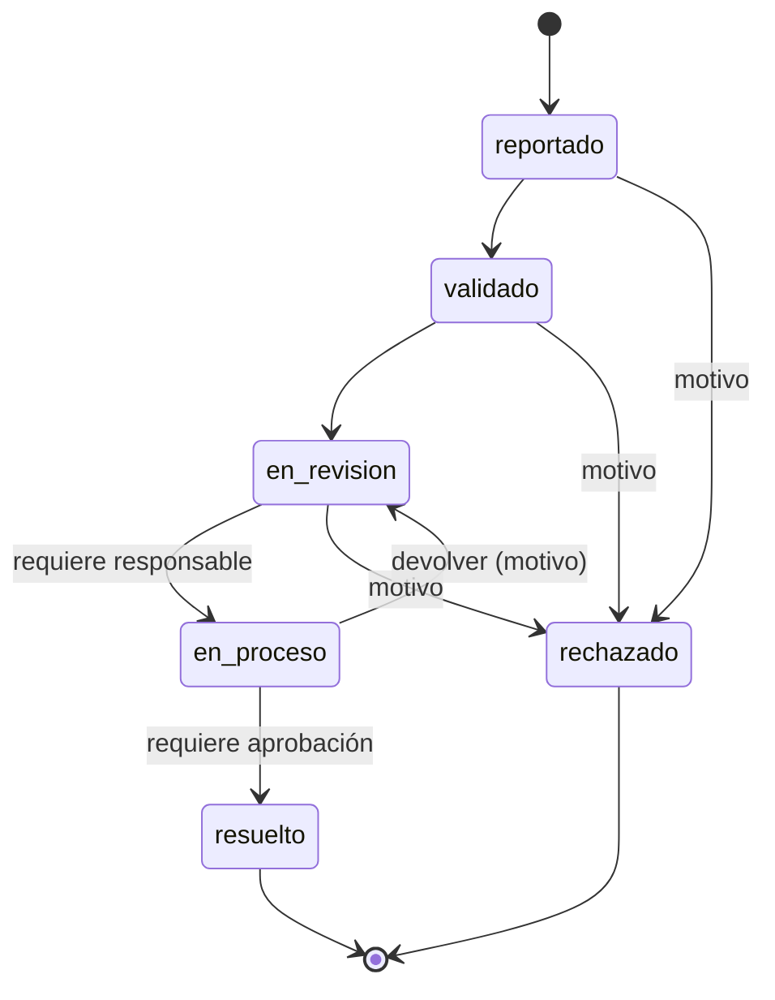

# Épica 2 — Gestión de Operaciones

Fuente: plan de trabajo de la Épica 2 (4 de noviembre de 2026), basado en el backlog del profesor
`backlog-gaps-experiencia-gestion-operativa.docx`. Las historias están desglosadas como issues en `docs/backlog/issues/HU-2.*.md`.

**Objetivo:** centralizar el registro, la asignación, el seguimiento, la aprobación y el análisis de operaciones.
**Alcance:** ciclo de vida, responsables, aprobaciones, alertas, incidencias, reportes y bitácora.

## Cómo aplicamos la épica a CiudadAlerta

En CiudadAlerta, una **operación es un reporte ciudadano** (propuesta del plan; validar con el PO, ver [preguntas abiertas](../preguntas-abiertas.md)).

| Concepto del backlog | En CiudadAlerta | Dónde está |
|---|---|---|
| Operación | Reporte con código único `CA-0001` (pantalla 07) | `reports.code`, secuencia `report_code_seq` |
| Tipos de operación | Alumbrado, Basura, Agua, Vías públicas (pantalla 08) | tabla `report_types` |
| Estados | Reportado → Validado → En revisión → En proceso → Resuelto · Rechazado (pantalla 13) | `backend/src/domain/operations.js` |
| Vencido | **Condición calculada**, no estado: abierto con fecha límite pasada ([ADR-003](../decisiones/ADR-003-operaciones.md)) | `isOverdue()` |
| Responsable | Técnico/cuadrilla con permiso `operaciones.update` | `reports.assignee_id` |
| Aprobación | El Supervisor aprueba antes de «Resuelto» (pasos configurables por tipo) | `approval_steps`, `report_approvals` |
| Incidencia operativa | Problema interno al atender el reporte (p. ej. «falta material») | `incidents`, `incident_events` |
| Alertas | Plazo por tipo; aviso «por vencer» y «vencido» sin repetir dentro de una ventana | `alerts.service.js` |

### Ciclo de vida

## Resumen

| HU | Historia | Persona | Pruebas |
|---|---|---|---|
| HU-2.1 | Panel de operaciones | D | `backend/test/hu-2.1-2.7.test.js` |
| HU-2.2 | Registro y seguimiento de operaciones | A | `backend/test/hu-2.2-2.8.test.js` |
| HU-2.3 | Asignación de responsables | B | `backend/test/hu-2.3-2.5.test.js` |
| HU-2.4 | Flujos de aprobación | C | `backend/test/hu-2.4-2.6.test.js` |
| HU-2.5 | Alertas y vencimientos | B | `backend/test/hu-2.3-2.5.test.js` |
| HU-2.6 | Incidencias operativas | C | `backend/test/hu-2.4-2.6.test.js` |
| HU-2.7 | Reportes operativos | D | `backend/test/hu-2.1-2.7.test.js` |
| HU-2.8 | Bitácora de cambios | A | `backend/test/hu-2.2-2.8.test.js` |

**Total: 46 SP** (A 13 · B 10 · C 13 · D 10). La base común se prueba en `backend/test/epica-2-base.test.js` y el flujo completo contra PostgreSQL en `backend/test/pg-integration.test.js`.

## Dónde quedó cada parte (por persona del plan)

| Persona | Servicios | Rutas | Pantallas |
|---|---|---|---|
| Base común | `operations-context.js`, `domain/operations.js`, migración `002`, repositorios | `routes.js` (registro) | `ops.jsx` |
| A | `reports.service.js`, `changelog.service.js` | `http/routes/reportes.js` | `NewReport`, `MyReports`, `Tracking`, `admin/Reports`, `admin/ReportDetail`, `admin/ChangeLog` |
| B | `assignments.service.js`, `alerts.service.js`, `notifications.service.js` | `http/routes/asignaciones.js` | `Notifications`, `admin/OpsConfig` (plazos y envíos) |
| C | `approvals.service.js`, `incidents.service.js` | `http/routes/aprobaciones.js` | `admin/Approvals`, `admin/Incidents`, `admin/OpsConfig` (pasos) |
| D | `indicators.service.js` | `http/routes/indicadores.js` | `admin/Dashboard`, `admin/OpsReport` |

## Requisitos transversales del backlog
- **Control de acceso por roles y permisos:** 7 módulos nuevos en la matriz de la Épica 1 ([roles y permisos](../roles-y-permisos.md)); cada endpoint exige su permiso.
- **Registro de acciones sin exponer contraseñas ni tokens:** toda modificación pasa por la bitácora (HU-2.8); `redact()` oculta claves como `password`, `token`, `hash`.
- **Validación con errores comprensibles:** mensajes en español y códigos estables (`invalid_transition`, `approval_pending`…).
- **Documentación y pruebas acordes con el riesgo:** 49 pruebas nuevas; las reglas más delicadas (transiciones, aprobaciones, bitácora inmutable, cuadre del panel) tienen prueba propia.

## Datos de ejemplo
`npm run db:demo` (en `backend/`, después de `db:setup`) crea un usuario por rol —contraseña `Demo-clave-123`— y reportes en todos los estados.

## Fuera de alcance de esta entrega
Fotografías del reporte (pantalla 09), mapa (05) y explorar (06), confirmaciones de vecinos («12 vecinos confirman»), ubicación con coordenadas, notificaciones push, escalamiento automático de vencidos.
