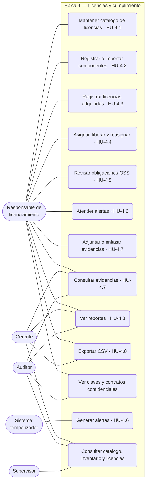
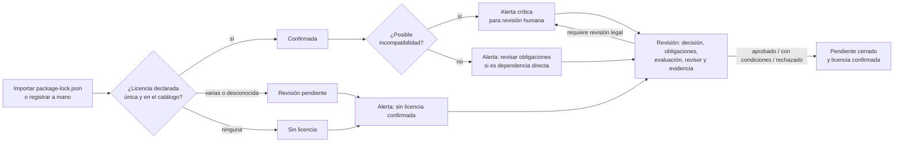
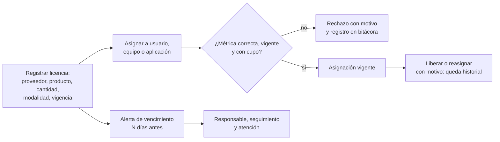

# Épica 4 — Gestión de Licenciamientos de Software

**Objetivo (backlog del profesor):** mantener un inventario trazable de productos y componentes, licencias, condiciones, asignaciones, vencimientos y evidencias.
**Alcance:** catálogo, inventario, licencias adquiridas, asignación, revisión de obligaciones, alertas y reportes.

## 1. Cómo aplicamos la épica a CiudadAlerta

CiudadAlerta es software libre (licencia MIT) hecho para una materia de tecnologías Open Source, así que la épica se aplica a **su propio software** y al software comercial que usa el municipio:

| Concepto del backlog | En CiudadAlerta |
|---|---|
| Aplicaciones y librerías | Las dependencias reales del proyecto, importadas de `backend/package-lock.json` y `frontend/package-lock.json`, más el software municipal registrado a mano. |
| Proyecto | `ciudadalerta-backend` (MIT), `ciudadalerta-frontend` (MIT) y `municipal` (software comercial). Cada proyecto tiene su propia licencia, que se usa para detectar posibles incompatibilidades. |
| Licencias propietarias | Las que compra el municipio: Microsoft 365 por usuario, ArcGIS Pro por equipo, Acrobat Pro perpetua… |
| Responsable de licenciamiento | Rol nuevo `licenciamiento` (ver [roles y permisos](../roles-y-permisos.md)). |
| Gerente · Auditor · Administrador | Roles existentes, con permisos nuevos de consulta, exportación o administración. |

## 2. Modelado funcional

### Módulos

| Módulo | Historias | Qué resuelve | Pantalla (*Licencias y cumplimiento*) |
|---|---|---|---|
| Catálogo de licencias | HU-4.1 | Qué permite y qué exige cada licencia, según qué fuente y desde cuándo | Catálogo de licencias |
| Inventario de software | HU-4.2 | Qué componentes usa cada proyecto, de dónde vienen y con qué licencia | Inventario de software |
| Revisión de obligaciones | HU-4.5 | Qué decidió una persona sobre cada componente, con qué evidencia | Ficha del componente |
| Licencias adquiridas | HU-4.3 | Qué compró el municipio, cuántas y hasta cuándo | Licencias adquiridas |
| Asignación y conciliación | HU-4.4 | Quién usa cada licencia y si cuadran las cantidades | Ficha de la licencia · Conciliación |
| Alertas de cumplimiento | HU-4.6 | Qué vence o está pendiente, quién lo atiende y qué se hizo | Alertas |
| Evidencias | HU-4.7 | Dónde está el contrato, el aviso o el informe que respalda cada decisión | Evidencias |
| Reportes | HU-4.8 | Foto del inventario y de los riesgos a una fecha de corte | Reportes |

### Actores y casos de uso

Quién hace qué, según los permisos sembrados ([roles y permisos](../roles-y-permisos.md#épica-4)). El Administrador puede lo mismo que el Responsable de licenciamiento.

### Proceso de cumplimiento Open Source

### Proceso de licencias adquiridas

### Entidades

`license_types` (catálogo) · `software_projects` · `software_components` · `component_reviews` · `purchased_licenses` · `license_assignments` · `license_evidences` · `compliance_alert_rules` · `compliance_alerts` · `compliance_alert_events`. El diagrama entidad-relación y sus restricciones están en el [modelo de datos](../modelo-datos.md#épica-4--gestión-de-licenciamientos).

## 3. Historias de usuario

Texto del backlog del profesor; los criterios se verifican en `backend/test/hu-4.x-licenciamientos.test.js` (20 pruebas) y `backend/test/pg-integration.test.js`.

Prioridad y puntos son los del backlog; las dependencias son las que resultaron al construirla (orden de implementación: 4.1 → 4.2 → 4.3 → 4.4 → 4.7 → 4.5 → 4.6 → 4.8).

| HU | Prioridad | SP | Depende de |
|---|---|---|---|
| HU-4.1 Catálogo de licencias | Crítica | 8 | Épica 1 (roles y permisos) |
| HU-4.2 Inventario de software | Crítica | 8 | HU-4.1 (licencia del componente) |
| HU-4.3 Licencias propietarias | Alta | 8 | Épica 1 |
| HU-4.4 Asignación y conciliación | Alta | 8 | HU-4.3 · Épica 1 (usuarios destinatarios) |
| HU-4.5 Revisión de obligaciones OSS | Alta | 8 | HU-4.1, HU-4.2 · HU-4.7 (evidencia de la revisión) |
| HU-4.6 Alertas de cumplimiento | Media | 5 | HU-4.2, HU-4.3, HU-4.5 · Épica 2 (notificaciones) |
| HU-4.7 Evidencias | Alta | 5 | HU-4.2, HU-4.3 |
| HU-4.8 Reportes | Media | 5 | HU-4.1 a HU-4.5 |

| HU | Historia | SP | Criterios de aceptación (verificables) | Reglas |
|---|---|---|---|---|
| **HU-4.1** Catálogo de licencias | Como responsable de licenciamiento quiero mantener licencias Open Source y propietarias para conocer sus condiciones. | 8 | Registrar nombre, tipo (SPDX), versión, fuente y resumen de obligaciones · categoría de la clasificación aprobada · atribución, redistribución, modificación y restricciones · fuente y fecha de verificación. Se siembran 14 licencias (MIT, Apache-2.0, GPL-3.0…). | RN-4.1, RN-4.2 |
| **HU-4.2** Inventario de software | Como administrador quiero registrar aplicaciones y librerías para conocer su procedencia y licencia. | 8 | Nombre, versión, repositorio, tipo y proyecto · asociar licencia o marcar revisión pendiente · fecha y responsable de incorporación · duplicados potenciales por nombre y versión · importación de `package-lock.json`. | RN-4.3, RN-4.4 |
| **HU-4.3** Licencias propietarias | Como encargado quiero registrar licencias comerciales y condiciones para controlar vigencia y uso. | 8 | Proveedor, producto, edición, cantidad, modalidad y vigencia · cantidades asignadas y disponibles · alertas de vencimiento con días de aviso por licencia · claves y contratos restringidos. | RN-4.6, RN-4.8 |
| **HU-4.4** Asignación y conciliación | Como administrador quiero asignar licencias a usuarios, equipos o aplicaciones para controlar su uso. | 8 | Destinatario, fecha y responsable · valida límite, métrica y vigencia · liberar o reasignar con motivo conservando historial · conciliación adquiridas / asignadas / disponibles. | RN-4.5 |
| **HU-4.5** Revisión de obligaciones OSS | Como responsable técnico quiero revisar obligaciones de dependencias para reducir riesgos de incumplimiento. | 8 | Obligaciones por componente y versión · componentes sin licencia confirmada · evaluación, decisión, revisor y evidencia · incompatibilidades potenciales **para revisión humana, no como dictamen legal**. | RN-4.7, RN-4.9 |
| **HU-4.6** Alertas de cumplimiento | Como responsable quiero recibir alertas de vencimientos y revisiones para actuar a tiempo. | 5 | Reglas por fecha, tipo y criticidad · pendientes, atendidas y vencidas · responsable y seguimiento · sin duplicados dentro de la ventana configurada. | RN-4.12 |
| **HU-4.7** Evidencias | Como auditor quiero consultar evidencias para verificar la trazabilidad de decisiones. | 5 | Adjuntar o enlazar contratos, avisos, atribuciones e informes · autor, fecha, versión y componente · acceso según clasificación · búsqueda por proyecto o componente. | RN-4.10, RN-4.11 |
| **HU-4.8** Reportes | Como gerente quiero generar reportes para planificar renovaciones y revisiones. | 5 | Por tipo de licencia, proyecto, proveedor, estado y vencimiento · sin licencia confirmada y revisiones pendientes · exportación para autorizados · fecha de corte y filtros. | RN-4.8 |

### 3.1 Trazabilidad: cada criterio y la prueba que lo demuestra

Los 32 criterios del backlog, tal como los escribió el profesor. «Prueba» es el nombre del caso en `backend/test/hu-4.x-licenciamientos.test.js` (PG = `pg-integration.test.js`, contra PostgreSQL real); «Qué se comprueba» es la aserción concreta.

| CA | Criterio | Prueba | Qué se comprueba |
|---|---|---|---|
| 4.1.1 | Registrar nombre, tipo, versión, fuente y resumen de obligaciones | «alta validada; identificador único» | Alta con SPDX, nombre, versión, obligaciones y fuente → 201; SPDX inválido → `invalid_spdx_id`; repetido (sin mayúsculas) → `license_type_exists` |
| 4.1.2 | Distinguir categorías según la clasificación aprobada | «catálogo sembrado» · «alta validada» | MIT = permisiva, GPL-3.0 = copyleft fuerte, filtro por categoría; categoría fuera de la lista → `invalid_category` (y `CHECK` en BD) |
| 4.1.3 | Registrar atribución, redistribución, modificación y restricciones | «catálogo sembrado» | MIT: atribución sí, redistribución permitida |
| 4.1.4 | Guardar fuente y fecha de verificación | «alta validada» | Fecha sin fuente → `source_required`; fecha futura → `invalid_verified_on`; queda quién verificó; cambiar condiciones borra la verificación |
| 4.2.1 | Registrar nombre, versión, repositorio, tipo y proyecto | «alta manual» | 201; proyecto inexistente → `invalid_project`; repositorio `javascript:` → `invalid_repository_url` |
| 4.2.2 | Asociar licencia o marcar revisión pendiente | «alta manual» · «duplicado potencial» · «importar package-lock.json» | Con licencia → confirmada; licencia desconocida o dual → pendiente; ninguna → sin licencia |
| 4.2.3 | Registrar fecha y responsable de incorporación | «alta manual» | `addedAt` y `addedByName` presentes |
| 4.2.4 | Identificar duplicados potenciales por nombre y versión | «no se repite en el proyecto» | Mismo proyecto → 409 `component_exists`; otro proyecto → 201 con `potentialDuplicates` |
| 4.3.1 | Registrar proveedor, producto, edición, cantidad, modalidad y vigencia | «licencia adquirida» | 201 con código `LIC-0001`; suscripción sin vencimiento → `expires_on_required`; cantidad 0 → `invalid_quantity` |
| 4.3.2 | Controlar cantidades asignadas y disponibles | «asignar respeta métrica, límite» | `available` baja a 0 y vuelve a 1 al liberar; no se puede bajar la cantidad por debajo de lo asignado |
| 4.3.3 | Generar alertas de vencimiento configurables | «licencia adquirida» · «el escaneo crea alertas» · «reglas configurables» | Días de aviso por licencia → «por vencer»; el escaneo crea la alerta de vencimiento; la regla cambia criticidad y ventana |
| 4.3.4 | Restringir contratos y claves confidenciales | «licencia adquirida» · «transversal» | Gerente y supervisor reciben clave y contrato vacíos; el auditor sí los ve; la clave nunca aparece en la bitácora |
| 4.4.1 | Registrar destinatario, fecha y responsable | «asignar respeta métrica, límite» | Cada asignación trae destinatario, `assignedAt` y `assignedByName` |
| 4.4.2 | Validar límites y condiciones configuradas | «asignar respeta…» · «una licencia vencida…» · PG | Métrica distinta → `wrong_target_type`; sin cupo → `no_licenses_available`; repetida → `already_assigned`; vencida → `license_expired`; 10 simultáneas sobre 3 cupos → pasan 3 |
| 4.4.3 | Liberar o reasignar conservando historial | «asignar respeta…» | Liberar exige motivo; reasignar deja 3 filas (ninguna se borra) con el motivo guardado |
| 4.4.4 | Comparar adquiridas, asignadas y disponibles | «conciliación» | Fila `[2, 1, 1, 1, cuadra]` |
| 4.5.1 | Registrar obligaciones por componente y versión | «revisión con decisión…» | La revisión guarda obligaciones y la versión del componente (`2.0.0`) |
| 4.5.2 | Identificar componentes sin licencia confirmada | «posible incompatibilidad» · «reporte» | Filtro `status=pendiente,sin_licencia`; sección «sin licencia confirmada» del reporte |
| 4.5.3 | Documentar evaluación, decisión, revisor y evidencia | «revisión con decisión…» · «adjuntar archivo» | Evaluación corta → `invalid_evaluation`; aprobar sin licencia → `license_required`; revisor registrado; evidencia inexistente → `invalid_evidence`; la revisión queda ligada a la evidencia |
| 4.5.4 | Marcar incompatibilidades potenciales para revisión humana, no como dictamen legal | «posible incompatibilidad» · «el escaneo crea alertas» · «exportar» | GPL directa en proyecto MIT se marca, GPL de desarrollo no; la alerta y el CSV dicen «no es un dictamen legal»; «requiere revisión legal» no cierra el pendiente |
| 4.6.1 | Configurar alertas por fecha, tipo y criticidad | «reglas configurables» | Criticidad inválida → `invalid_criticality`; el gerente no puede cambiar reglas (403) |
| 4.6.2 | Mostrar alertas pendientes, atendidas y vencidas | «responsable, seguimiento y atención» | `counts` con atendida y vencida; el filtro `state=vencida` solo devuelve vencidas |
| 4.6.3 | Registrar responsable y seguimiento | «responsable, seguimiento y atención» | Historial `creada → responsable → seguimiento → atendida`; atender exige comentario; un ciudadano no puede ser responsable |
| 4.6.4 | Evitar duplicadas dentro de la ventana configurada | «sin duplicarlas» · «ventana anti-repetición» · PG | Segundo escaneo crea 0; dentro de la ventana no se repite aunque esté atendida, pasada la ventana sí; índice único parcial en BD |
| 4.7.1 | Adjuntar o enlazar contratos, avisos, atribuciones e informes | «evidencias ligadas» · «adjuntar archivo» | Enlace a contrato y atribución; PDF adjunto; un ejecutable con `Content-Type` de PDF → 415 |
| 4.7.2 | Registrar autor, fecha, versión y componente | «evidencias ligadas» · «adjuntar archivo» | `authorName`, `createdAt`, `version` y componente; sin relación → `evidence_unlinked` |
| 4.7.3 | Restringir acceso según clasificación | «evidencias ligadas» | La confidencial no aparece al gerente y responde 404; el auditor la ve |
| 4.7.4 | Buscar por proyecto o componente | «evidencias ligadas» · «adjuntar archivo» | `?project=` y `?component=` devuelven la evidencia correcta |
| 4.8.1 | Reportar por tipo de licencia, proyecto, proveedor, estado y vencimiento | «reporte por tipo…» | Filtros proyecto y proveedor; agrupado por categoría; vigencia de cada licencia; filtro inválido → 400 |
| 4.8.2 | Identificar sin licencia confirmada y revisiones pendientes | «reporte por tipo…» | Secciones `unconfirmed` y `flagged` |
| 4.8.3 | Exportar para usuarios autorizados | «exportar solo con permiso» | Auditor (solo consulta) → 403; gerente → CSV |
| 4.8.4 | Mostrar fecha de corte y filtros aplicados | «reporte por tipo…» · «exportar» | `cutoff` y `filters` en JSON; «Fecha de corte» y el filtro en el CSV |

## 4. Reglas de negocio

«Dónde» indica qué capa la hace cumplir: **BD** = restricción de PostgreSQL (se cumple aunque alguien salte la API) · **Servicio** = `backend/src/services/`.

| # | Regla | Dónde | Prueba |
|---|---|---|---|
| RN-4.1 | Cada licencia tiene un identificador SPDX (o `LicenseRef-…`) único sin distinguir mayúsculas, y una categoría de la clasificación aprobada: permisiva, copyleft débil, copyleft fuerte, dominio público, propietaria u otra. | BD `UNIQUE`, `CHECK` · Servicio | HU-4.1 |
| RN-4.2 | Marcar una licencia como verificada exige la fuente consultada y una fecha no futura. Si cambian sus condiciones sin nueva verificación, vuelve a «sin verificar». | BD `CHECK` · Servicio | HU-4.1 |
| RN-4.3 | Un componente queda **confirmado** solo con una licencia del catálogo. Si el manifest declara varias (`MIT OR Apache-2.0`) o una desconocida, queda **revisión pendiente** para que una persona decida; si no declara ninguna, **sin licencia**. | BD `CHECK` · Servicio | HU-4.2 |
| RN-4.4 | Un mismo nombre (sin mayúsculas) y versión no se repite dentro de un proyecto; en otro proyecto se registra y se avisa como **duplicado potencial**. | BD índice único · Servicio | HU-4.2 |
| RN-4.5 | Una asignación debe coincidir con la métrica de la licencia (usuario, equipo o aplicación), con la licencia activa y vigente; nunca se asignan más de las adquiridas, aun con solicitudes simultáneas; un destinatario no tiene dos asignaciones vigentes de la misma licencia; la cantidad no puede bajar de lo ya asignado. Liberar exige motivo y conserva la fila. | BD `CHECK assigned <= quantity`, índice único parcial, `UPDATE` condicional atómico · Servicio | HU-4.4 · PostgreSQL (10 simultáneas sobre 3) |
| RN-4.6 | Una suscripción siempre tiene vencimiento, posterior al inicio. Vigencia: **vencida** si pasó la fecha, **por vencer** dentro de los días de aviso de esa licencia, si no **vigente**. | BD `CHECK` · `domain/licensing.js` | HU-4.3 |
| RN-4.7 | Una revisión exige decisión, obligaciones, evaluación y revisor; aprobar exige indicar la licencia aplicable, que queda confirmada. La evidencia es opcional pero debe existir. Las decisiones aprobado, con condiciones o rechazado cierran el pendiente; «requiere revisión legal» no. | Servicio · BD solo inserción | HU-4.5 |
| RN-4.8 | Claves de licencia y referencias de contrato solo las ven y registran usuarios con el permiso `confidencial`; para los demás llegan vacías y marcadas como restringidas. Nunca se escriben en la bitácora. | Servicio · bitácora con redacción | HU-4.3 · transversal |
| RN-4.9 | Se marca **posible incompatibilidad** cuando hay copyleft fuerte en un proyecto permisivo o propietario (salvo dependencias de desarrollo), un componente propietario en un proyecto abierto o una licencia sin categoría. Es una ayuda para la revisión humana, **no un dictamen legal**; así se indica en la pantalla, la alerta y el CSV. | `domain/licensing.js` | HU-4.5 |
| RN-4.10 | Una evidencia es un enlace http(s) o un archivo PDF, PNG, JPG o de texto de hasta 5 MB, cuyo tipo se verifica por su contenido; siempre se relaciona con un proyecto, componente o licencia. Las **confidenciales** no existen (404) para quien no tiene el permiso `confidencial`; los archivos no tienen ruta pública. | BD `CHECK` · Servicio | HU-4.7 |
| RN-4.11 | Revisiones, evidencias y seguimiento de alertas son de solo inserción: una versión nueva es otra fila. Toda acción, también la rechazada, queda en la bitácora de cambios. | BD triggers · Servicio | PostgreSQL · transversal |
| RN-4.12 | No hay dos alertas **pendientes** del mismo tipo para la misma licencia o componente, ni se repite una alerta dentro de la ventana de su regla aunque ya esté atendida. Atender exige comentario. Vencida = pendiente con la fecha límite pasada. | BD índice único parcial · Servicio | HU-4.6 · PostgreSQL |

## 5. Respuestas a las preguntas de refinamiento

| Pregunta del backlog | Decisión provisional |
|---|---|
| ¿Se requiere importar SBOM, manifests o inventarios? | Sí: se importa `package-lock.json` (npm, versiones 2 y 3), directas por defecto o el árbol completo. Otros formatos (CycloneDX, SPDX) quedan anotados en [preguntas abiertas](../preguntas-abiertas.md). |
| ¿Qué política define la aprobación de licencias y la escalación? | Las reglas RN-4.9 y RN-4.12 con criticidad configurable; la decisión «requiere revisión legal» mantiene el pendiente abierto. |
| ¿Quién valida las interpretaciones y decisiones? | El rol **Responsable de licenciamiento** (o un administrador). El sistema nunca aprueba ni rechaza solo: marca, alerta y registra quién decidió y con qué evidencia. |

## 6. Demostración en vivo

`npm run db:setup` y `npm run db:demo` crean el usuario `licencias@demo.local` (contraseña `Demo-clave-123`), importan las dependencias reales del proyecto (50 componentes), registran 3 licencias comerciales (Microsoft 365 a punto de vencer), un componente AGPL en software comercial y otro sin licencia, y generan las primeras alertas.

1. **Inventario:** importar `frontend/package-lock.json` (no repite nada) y filtrar «Posible incompatibilidad».
2. **Revisión:** abrir Ghostscript, leer el aviso y registrar la revisión con evidencia.
3. **Licencias adquiridas:** asignar ArcGIS Pro a un equipo hasta llenar el cupo; ver la conciliación.
4. **Confidencialidad:** entrar como `gerente@demo.local`: ve la licencia pero no la clave ni el contrato.
5. **Alertas:** asignar responsable, dar seguimiento y atender el vencimiento de Microsoft 365.
6. **Reportes:** filtrar y exportar el CSV con fecha de corte.

Evidencia: [`docs/evidencia/epica-4/`](../evidencia/epica-4/).

## 7. Requisitos transversales del backlog

| Requisito | Cómo se cumple | Prueba |
|---|---|---|
| Control de acceso por roles y permisos | 5 módulos de permiso nuevos; cada una de las 32 rutas declara el suyo; `confidencial` filtra datos dentro del servicio, no solo la pantalla | 403 en cada HU para el rol sin permiso; «transversal» (el ciudadano no ve nada) |
| Registrar acciones y errores sin exponer secretos | Toda acción, también la rechazada, queda en la bitácora de cambios; claves de licencia y referencias de contrato se redactan | «transversal»: rechazo `no_licenses_available` registrado y la clave ausente de la bitácora |
| Validar entradas y comunicar errores comprensibles | Cada error tiene un código estable (`no_licenses_available`…) y un mensaje en español que la pantalla muestra tal cual («No quedan licencias disponibles de ArcGIS Pro: 2 de 2 asignadas.») | Los códigos de error se comprueban en todas las pruebas de la épica |
| Documentación técnica/operativa y pruebas acordes con el riesgo | Este documento, [modelo de datos](../modelo-datos.md), [arquitectura](../arquitectura.md), [ADR-004](../decisiones/ADR-004-licenciamiento.md), [API](../api.md); lo de mayor riesgo (cupos, confidencialidad, historial) se prueba también contra PostgreSQL | 20 pruebas en memoria + la prueba de la Épica 4 en `pg-integration.test.js` |

## 8. Definición de terminado (DoD)

| Condición del backlog | Estado | Evidencia |
|---|---|---|
| Criterios de aceptación demostrados y aprobados por el responsable funcional | Demostrados; falta la aprobación del responsable funcional (profesor / PO) | Sección 3.1 y la demostración de la sección 6 |
| Código revisado y pruebas pertinentes ejecutadas; defectos críticos resueltos | Hecho | `npm test`: todo en verde en memoria y con `TEST_DATABASE_URL` en PostgreSQL; sin defectos abiertos |
| Documentación actualizada y evidencia verificable disponible | Hecho | Documentos de la sección 7 y capturas en [`docs/evidencia/epica-4/`](../evidencia/epica-4/) |
| Cambio desplegado en el ambiente acordado, cuando aplique | Al integrar en `main`: `npm run db:setup` aplica la migración 004 | — |
