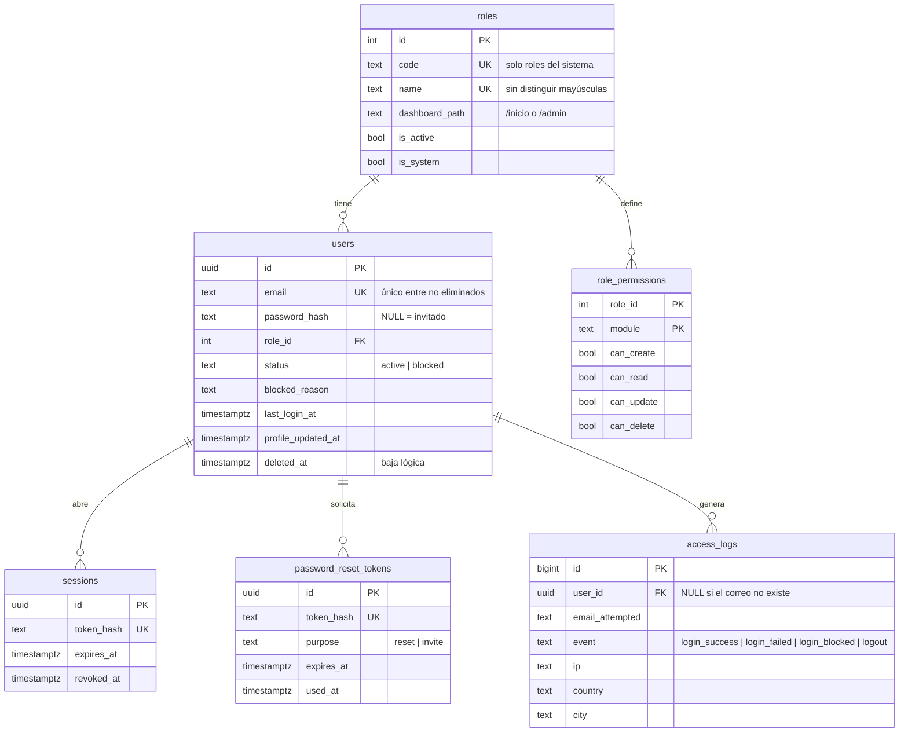
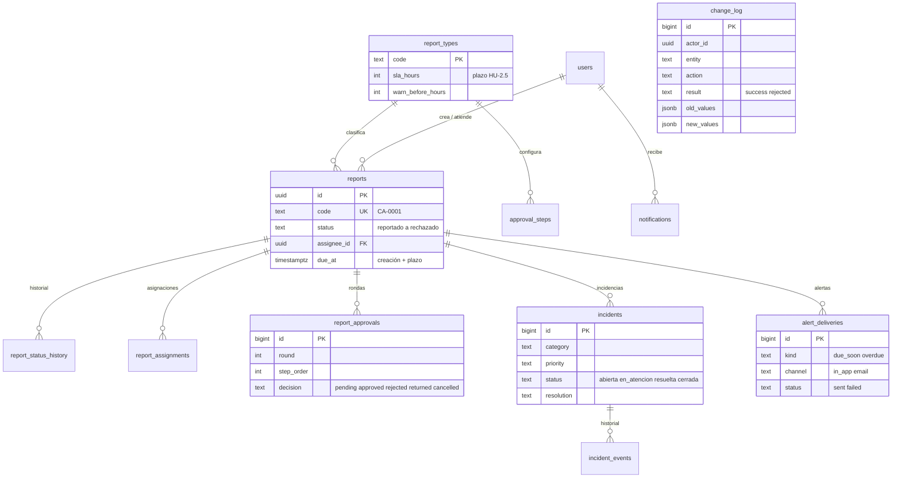
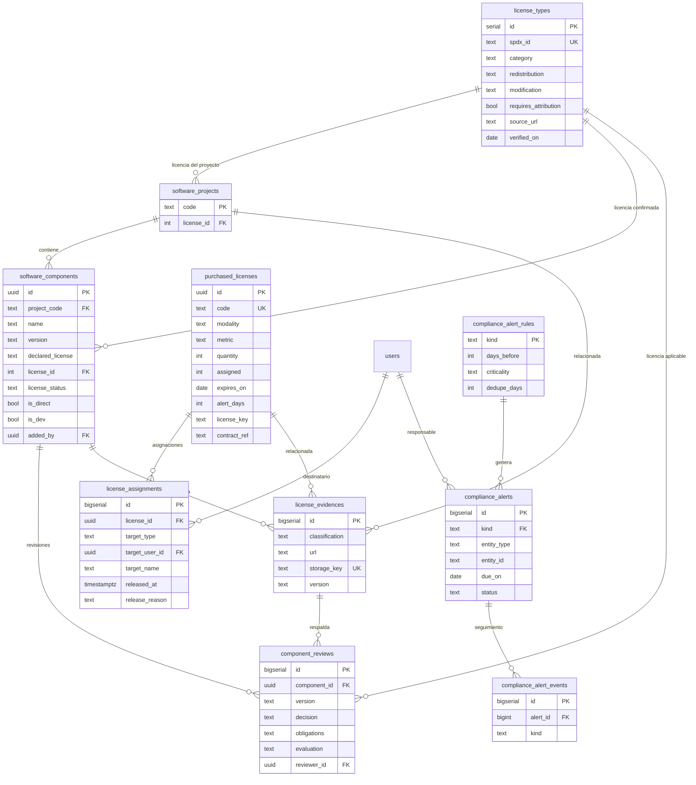

# Modelo de datos (Épica 1)

Migración: [`backend/migrations/001_usuarios_roles_y_acceso.sql`](../backend/migrations/001_usuarios_roles_y_acceso.sql).

## Decisiones
- **Permisos como matriz** (`role_permissions`) en vez de un catálogo de permisos: es exactamente lo que pide HU-1.4 (módulo × 4 acciones) y la pantalla es una tabla de casillas. Si luego se necesitan permisos más finos (p. ej. «cerrar reporte»), se agrega un módulo o una tabla `permissions`.
- **Baja lógica de usuarios** (`deleted_at`): conserva el historial de auditoría. El índice único del correo ignora los eliminados.
- **`access_logs.user_id` con `ON DELETE SET NULL`** y `email_attempted` siempre guardado: los intentos con correos inexistentes también quedan registrados.
- **Tokens y sesiones guardan solo hash**: una filtración de la BD no entrega sesiones ni enlaces válidos.
- `sector` es texto libre por ahora; cuando exista el mapa (Épica 2) conviene un catálogo de sectores.

# Épica 2 — Gestión de operaciones

Migración: [`backend/migrations/002_operaciones.sql`](../backend/migrations/002_operaciones.sql). Decisiones en [ADR-003](decisiones/ADR-003-operaciones.md).

## Decisiones (Épica 2)
- **`change_log` sin claves foráneas a reportes y con `actor_name` copiado:** la bitácora sobrevive aunque se borre un usuario o un reporte. Un trigger impide UPDATE, DELETE y TRUNCATE.
- **`report_approvals` copia nombre, rol y obligatoriedad del paso:** cambiar la configuración no altera rondas en curso.
- **Índice parcial `reports_due_open_idx`** solo sobre reportes abiertos: es lo que consulta la revisión de alertas.
- **`alert_deliveries_dedupe_idx`** (reporte, usuario, tipo, fecha): permite saber rápido si una alerta ya se envió dentro de la ventana.

# Épica 4 — Gestión de licenciamientos

Migración [`004_licenciamientos.sql`](../backend/migrations/004_licenciamientos.sql). Reglas RN-4.x en [epica-4.md](backlog/epica-4.md#4-reglas-de-negocio).

## Integridad que garantiza la base de datos (Épica 4)

Estas reglas se cumplen aunque alguien escriba directo en PostgreSQL saltando la API; `backend/test/pg-integration.test.js` las prueba.

| Restricción | Tabla | Protege |
|---|---|---|
| `UNIQUE (spdx_id)` · `CHECK category IN (…)` · `CHECK redistribution / modification IN (…)` | `license_types` | RN-4.1: clasificación aprobada, sin repetidos |
| `CHECK (verified_on IS NULL OR source_url IS NOT NULL OR spdx_id LIKE 'LicenseRef-%')` | `license_types` | RN-4.2: no hay verificación sin fuente |
| `CHECK (license_status <> 'confirmada' OR license_id IS NOT NULL)` | `software_components` | RN-4.3: no hay «confirmada» sin licencia |
| Índice único `(project_code, lower(name), version)` | `software_components` | RN-4.4: sin repetidos dentro del proyecto |
| `CHECK (assigned >= 0)` · `CHECK (quantity IS NULL OR assigned <= quantity)` | `purchased_licenses` | RN-4.5: nunca más asignadas que adquiridas |
| `UPDATE … SET assigned = assigned + 1 WHERE assigned < quantity` e `INSERT` en una sola sentencia | `purchased_licenses`, `license_assignments` | RN-4.5 con solicitudes simultáneas (10 a la vez sobre 3 cupos: pasan 3) |
| Índice único parcial `(license_id, target_type, coalesce(target_user_id, lower(target_name))) WHERE released_at IS NULL` | `license_assignments` | RN-4.5: sin asignación vigente duplicada; compara el id del usuario, no su nombre |
| `CHECK ((target_type = 'usuario') = (target_user_id IS NOT NULL))` · `CHECK (released_at IS NULL OR (released_by IS NOT NULL AND release_reason IS NOT NULL))` | `license_assignments` | Destinatario coherente; liberar exige quién y por qué |
| `CHECK (modality <> 'suscripcion' OR expires_on IS NOT NULL)` · `CHECK (expires_on >= starts_on)` · `CHECK (alert_days BETWEEN 0 AND 365)` | `purchased_licenses` | RN-4.6 |
| `CHECK (url IS NOT NULL OR storage_key IS NOT NULL)` · `CHECK ((storage_key IS NULL) = (file_name IS NULL))` | `license_evidences` | RN-4.10: enlace o archivo, nunca ninguno |
| Índice único parcial `(kind, entity_type, entity_id) WHERE status = 'pendiente'` con `ON CONFLICT DO NOTHING` | `compliance_alerts` | RN-4.12: sin alertas pendientes duplicadas |
| `CHECK ((status = 'atendida') = (attended_at IS NOT NULL))` | `compliance_alerts` | Estado coherente con su fecha |
| Trigger `licensing_append_only` (UPDATE o DELETE dan error) | `component_reviews`, `license_evidences`, `compliance_alert_events` | RN-4.11: trazabilidad que no se puede reescribir |
| Claves foráneas a `users`, `software_projects`, `license_types`, `purchased_licenses`, `compliance_alert_rules` | todas | Integridad referencial: sin huérfanos |

## Decisiones (Épica 4)
- **El contador `assigned` vive en la licencia**, además de las filas de asignación, para que el control de cupo sea una sola sentencia atómica. La pantalla de conciliación verifica que coincida con las asignaciones vigentes.
- **Liberar no borra:** la asignación se cierra con fecha, responsable y motivo. Reasignar es liberar y asignar.
- **`declared_license` se guarda aparte de `license_id`:** se conserva lo que dijo el proveedor aunque una persona decida otra cosa.
- **Las alertas apuntan a su entidad con `entity_type` + `entity_id`** (licencia o componente) en lugar de dos claves foráneas, para que agregar otro tipo de alerta no cambie el esquema.
