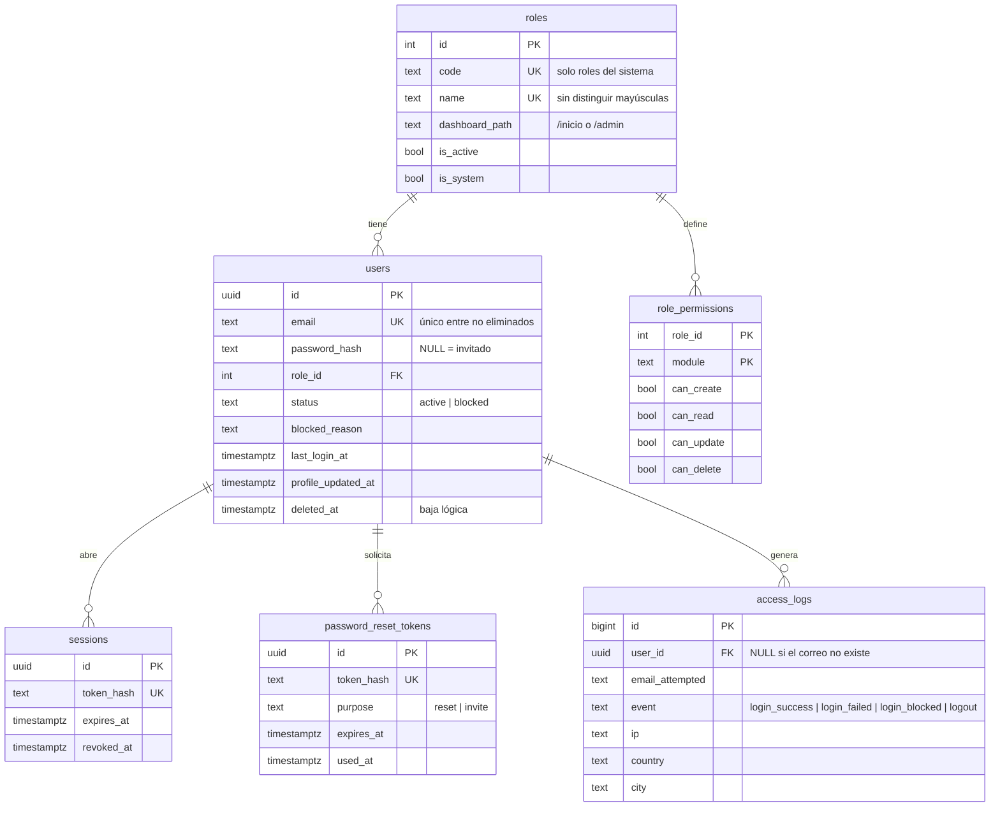
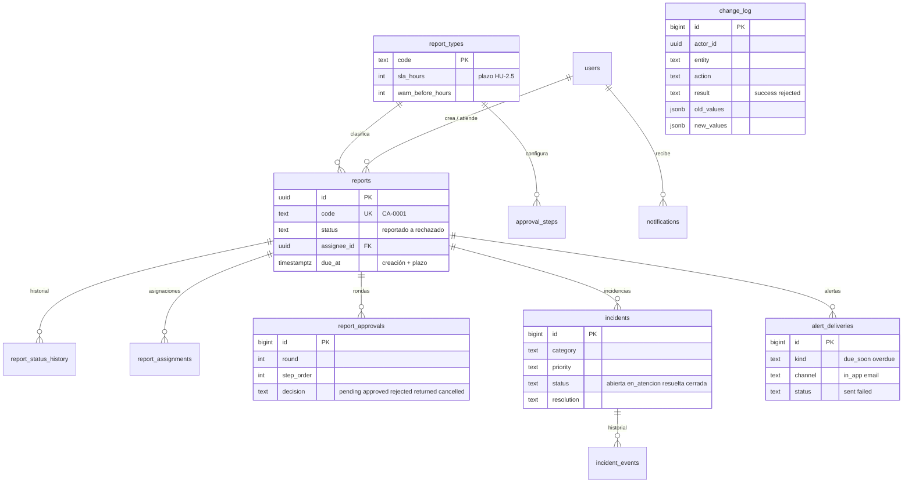

# Modelo de datos (Épica 1)

Migración: [`backend/migrations/001_usuarios_roles_y_acceso.sql`](../backend/migrations/001_usuarios_roles_y_acceso.sql).

## Decisiones
- **Permisos como matriz** (`role_permissions`) en vez de un catálogo de permisos: es exactamente lo que pide HU-1.4 (módulo × 4 acciones) y la pantalla es una tabla de casillas. Si luego se necesitan permisos más finos (p. ej. «cerrar reporte»), se agrega un módulo o una tabla `permissions`.
- **Baja lógica de usuarios** (`deleted_at`): conserva el historial de auditoría. El índice único del correo ignora los eliminados.
- **`access_logs.user_id` con `ON DELETE SET NULL`** y `email_attempted` siempre guardado: los intentos con correos inexistentes también quedan registrados.
- **Tokens y sesiones guardan solo hash**: una filtración de la BD no entrega sesiones ni enlaces válidos.
- `sector` es texto libre por ahora; cuando exista el mapa (Épica 2) conviene un catálogo de sectores.

# Épica 2 — Gestión de operaciones

Migración: [`backend/migrations/002_operaciones.sql`](../backend/migrations/002_operaciones.sql). Decisiones en [ADR-003](decisiones/ADR-003-operaciones.md).

## Decisiones (Épica 2)
- **`change_log` sin claves foráneas a reportes y con `actor_name` copiado:** la bitácora sobrevive aunque se borre un usuario o un reporte. Un trigger impide UPDATE, DELETE y TRUNCATE.
- **`report_approvals` copia nombre, rol y obligatoriedad del paso:** cambiar la configuración no altera rondas en curso.
- **Índice parcial `reports_due_open_idx`** solo sobre reportes abiertos: es lo que consulta la revisión de alertas.
- **`alert_deliveries_dedupe_idx`** (reporte, usuario, tipo, fecha): permite saber rápido si una alerta ya se envió dentro de la ventana.
